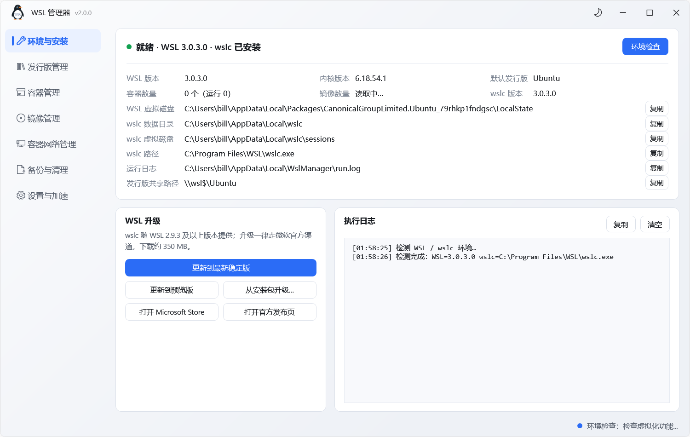

# WSL 管理器

**版本 2.0 · 开发者 BillChen · MIT License**

> **v2.0 = 发行版管理 + 容器（wslc）管理合体版。** v1.x 只有 WSL 发行版管理，**仍然可用**（见
> [`v1.1`](https://github.com/cjx2022/WslManager/tree/v1.1) 标签）；v2.0 在它之上并入了完整的 wslc 容器模块
> —— 容器 / 镜像 / 容器网络 / 备份与清理 / 环境与安装 / 镜像加速，两套界面合进同一个窗口（左侧导航切换）。
>
> 本版关键修正：
> - **发行版卡片 CPU / 内存利用率**：改为在发行版内读 `/proc/stat` 与 `/proc/meminfo`（一次 exec 取两项），
>   不再依赖被系统保护的 `Vmmem/VmmemWSL` 进程 —— 旧实现 `TotalProcessorTime` 一访问就抛 `AccessDenied`，
>   整段被一个 `try` 兜住连内存一起丢，卡片正中一片空白。两行**同字号同字重**、**只有百分比数字变色**
>   （`<60%` 绿 / `60~85%` 黄 / `≥85%` 红）、放进同一个 Grid 共享列宽，数字严格对齐。
> - **路径全部可复制**：WSL 虚拟磁盘 / wslc 数据目录 / wslc 虚拟磁盘 / wslc.exe / 运行日志 /
>   发行版共享路径 / 配置文件 / 会话虚拟磁盘 / 镜像索引 —— 都是排障时要粘给别人的东西。
> - **复制提示不再误报失败**：`Clipboard.SetDataObject` 抛异常**不等于没写进去**（OleSetClipboard 已成功、
>   后续阶段被抢占同样会抛），旧实现只看异常就报「复制失败」，于是出现「提示失败、实际能粘出来」；
>   现在以**回读剪贴板是否一致**为唯一判据。
> - 托盘菜单精简为「打开主界面 / 退出」（开机、关机、内存等操作都在主界面里）；内外 logo 换成几何企鹅；
>   环境检查收进弹出卡片，页面上只留一行结论。



用 **C# + WPF**（.NET 8）写的 WSL 发行版管理工具——状态管理、**安装**、**卸载** 一站式操作，Windows 11 Fluent 风格界面（Mica 背景、圆角卡片、明暗主题、系统托盘）。

0.1 版（VB.NET 状态管理器）见 [`v0.1` 标签](https://github.com/cjx2022/WslManager/tree/v0.1)。

## 功能

| 功能 | 说明 |
|---|---|
| 状态总览 | 发行版名称、运行状态、WSL 版本、IP 地址、已运行时长，每 5 秒后台静默刷新 |
| 开机 | 单个发行版启动 |
| 关机（软关机） | 以 root 在发行版内执行 `shutdown -h now`，等待其自行停机；超时（20 秒）才强制终止 |
| 强制关机 | 卡片「更多」菜单里，直接 `wsl -t`，不等待软关机 |
| 重启 | 软关机后再开机 |
| 全部开机 / 全部关机 | 批量启动所有停止的发行版；关机时先对所有运行中的发行版发软关机指令，稍等后用 `wsl --shutdown` 兜底 |
| **安装发行版**（1.0 新增） | 两级选择：官方在线列表（22 个）∪ 镜像目录特供；官方下载源与国内镜像（清华 TUNA / 阿里云 / USTC / 华为云）分组显示，**测速择优**、缓存下载、实时进度与速度、任务可随时终止 |
| **卸载发行版**（1.0 新增） | 导出备份后，勾选知晓并输入完全一致的发行版名称确认，再执行卸载 |
| **环境检查**（1.0 新增，v2.0 并入环境与安装页，v2.0 改弹出卡片） | 9 项检查：Windows 版本、WSL 组件、WSL 状态、系统服务、Windows 功能、CPU 虚拟化、磁盘空间、管理员权限、网络连通性，每项附官方文档链接；点「环境检查」弹出卡片跑检查，页面只留一行结论小字 |
| **一键修复 / 单项修复**（1.1 新增） | 未通过的项目若可自动处理，行内直接出现「修复」按钮；标题栏「一键修复（N）」按顺序批量处理全部可修复项，修完自动复查并高亮结果。不支持自动修复的项（CPU 虚拟化、磁盘空间、网络）保留文档入口手动处理 |
| **下载管理**（1.0 新增） | 查看 / 打开 / 删除本地已缓存的安装包 |
| 打开终端 | 优先 Windows Terminal，未安装则回退 conhost |
| 打开文件 | 资源管理器打开 `\\wsl$\<发行版>` |
| 更多操作 | 设为默认发行版、复制 IP、复制名称、强制关机、**卸载该发行版** |
| **发行版管理页**（v2.0 并入） | 左侧导航第二页，与 v1.1 的发行版模块功能一致：状态卡片、开机/关机/重启、全部开关机、自动刷新、终端/文件、设为默认、复制 IP、卸载；卡片正中显示 **CPU / 内存利用率**（v2.0，WSL2 虚拟机整体读数） |
| **容器（wslc）模块** | 环境与安装（WSL 环境信息为主模块 + WSL 升级 + 环境检查按钮→v2.0 起弹出卡片）、容器新生命周期与性能监控、镜像拉取/检索/存档、容器网络管理、磁盘备份与压缩、镜像加速设置 |
| 系统托盘 | 关闭窗口即最小化到托盘；菜单只剩「打开主界面 / 退出」（v2.0 精简）；图标 = 正式企鹅 logo，运行状态靠右下角小绿点（绿=有运行中） |
| 明暗主题 | 跟随系统，点标题栏图标可手动切换并记忆；深浅模式强调色一致 |
| 关于 | 状态栏右下角「关于」文本，查看版本、开发者与版权声明 |

## 安装发行版

1. **选发行版**：`wsl --list --online` 官方全量列表 ∪ 镜像目录特供（如 Alpine）；选中即自动测速当前源
2. **选下载源**：官方在线（微软商店在线安装）或国内镜像（清华 TUNA / 阿里云 / USTC / 华为云）

测速与下载策略：

- 测速：读满 4MB 或 8 秒出真实速度，12 秒兜底超时；≥1024 KB/s 显示 MB/s，慢速源显示真实低速而非超时
- 下载：不限总时长 + 60 秒首字节 / 读取停滞看门狗——慢但有进展即可完成，失败自动清理半成品
- 缓存：已下载的安装包保留在 `%LOCALAPPDATA%\WslManager\downloads`，命中缓存直接进入安装
- 格式自动处理：`.wsl` → `wsl --install --from-file`，`.tar.gz` → `wsl --import`
- 任务进行中头部出现「终止」按钮，可随时取消（同时清理半成品）

## 卸载发行版

主窗口「卸载发行版」按钮或卡片「…」菜单进入：

1. 选择发行版（显示安装路径、占用空间、状态）
2. 导出备份到 `%LOCALAPPDATA%\WslManager\backup\`（可勾选「卸载前自动导出」）
3. 勾选知晓并**输入完全一致的发行版名称** → 执行卸载

## 内存（v2.0）

首帧显示后进程会冲到 300 MB 左右，原因是硬件渲染要把 D3D 设备 + 显卡用户态驱动整片读进工作集（不是泄漏）：构造完 100 MB → 首帧 275~310 MB。v2.0 的处理：

- **首帧稳定 1.5 秒后自动回收一次**：GC + `EmptyWorkingSet`，任务管理器上的数字直接从 275 MB 落到 10~65 MB（不用再手动关一次窗口）
- **切换模块后再回收一次**（容器页第一次建可视化树会涨 ~20 MB）
- **进托盘时回收**（原有行为）
- 托盘右键多了三项：`内存占用：xx MB`（只读）、`立即释放内存`、`低内存模式（软件渲染，重启生效）`

需要说清的是：回收只把页交还系统，不改真实提交量。硬件渲染下的私有内存约 200~230 MB，其中 ~140 MB 是显卡驱动；**只有软件渲染能真正省下来**（私有 60~90 MB），代价是 ClearType 关闭、小字抗锯齿略降。默认仍是硬件渲染。

配置项（`%LOCALAPPDATA%\WslManager\settings.ini`）：

| 键 | 缺省 | 说明 |
|---|---|---|
| `TrimOnStartup` | 1 | 首帧后 / 切模块后的自动回收，写 `0` 关掉 |
| `TrimOnHide` | 1 | 进托盘时回收 |
| `RenderMode` | Auto | 写 `Software` 用软件渲染（低内存、文字略糊），`Auto` 为硬件加速 |

## 模块切换（v2.0）

标题栏左上角的「发行版 / 容器」是模块切换，不是两个进程：

| 模块 | 内容 | 说明 |
|---|---|---|
| 发行版 | 发行版状态、开机/关机/重启、安装发行版、卸载发行版、环境检查与修复 | 原有 WSL 管理，行为不变 |
| 容器 | 环境与安装、容器管理、镜像管理、容器网络管理、备份与清理、设置与加速 | 由 WSLC 容器管理器整页并入，依赖 WSL 2.9.3+ 提供的 `wslc` |

几个实现要点：

- 容器页**首次切过去时才创建**，不切就不占内存；切走后发行版页的 5 秒轮询会暂停
- 两个模块**共用同一个窗口与托盘**，最小化/关闭行为一致
- 容器模块**已跟随宿主浅/深主题**（v2.0）：调色板拆成 `Wslc/Themes/Palette.Light.xaml` 与 `Palette.Dark.xaml`，切主题时整份替换，不需要重建容器页；后打开的对话框也会自动套用当前主题
- 容器模块的**镜像存档**（`image save -o` / `image load -i`，保留标签）与**备份与清理**（`container export` / `image import`，容器文件系统、无标签）是两条不同的链，别混
- 容器列表**恒含已停止容器**（等价 `wslc ps -a`）：已停止的容器才找得到「启动」按钮，所以没有「显示已停止」开关
- 容器页打开的所有对话框（新建容器 / 详情 / 日志 / 终端）仍是独立窗口，属主为主窗口，行为与原来一致

## 关机方式说明

| 方式 | 命令 | 数据安全 |
|---|---|---|
| 关机（默认，软关机） | `wsl -d X -u root -- /sbin/shutdown -h now` → 轮询等待停止 | 走发行版内部关机流程，服务正常退出、缓存落盘 |
| 强制关机 | `wsl -t X` | 相当于直接掐掉虚拟机，未落盘的数据可能丢失 |
| 全部关机 | 逐个发软关机指令 → `wsl --shutdown` 兜底 | 同上，软关机失败的部分由 `--shutdown` 兜底 |

默认走软关机。若软关机指令没送达（例如发行版内没有 shutdown 或权限异常），会先执行一次 `sync` 刷盘再强制终止，尽量降低数据风险。

## 界面

- 无边框窗口 + 自定义标题栏（拖动、双击最大化）
- 自绘的 Mica 质感渐变背景 + 系统圆角，系统主题色作为强调色（深浅模式一致）
- 扁平卡片、发丝分隔线、下拉列表等全部主题化，明暗切换无白底白字
- 卡片悬停上浮、状态点脉冲、开关滑动等动效

## 命令行用法

适合写进批处理 / 计划任务：

```
WslManager.exe --status              :: 查询所有发行版状态（-q）
WslManager.exe --start Ubuntu        :: 开机（-s）
WslManager.exe --stop Ubuntu         :: 软关机（失败则强制终止）（-t）
WslManager.exe --force-stop Ubuntu   :: 强制关机（wsl -t，不等待）（-f）
WslManager.exe --restart Ubuntu      :: 重启（-r）
WslManager.exe --shutdown            :: 全部关机（-k）
WslManager.exe --tray                :: 后台常驻（只显示托盘图标，不弹窗口）（-b）
WslManager.exe --page=distro         :: 启动后直接落在「发行版管理」页（同样可 env/container/image/network/backup/settings）
WslManager.exe --module=wslc         :: 兼容旧参数：现在只有这一个模块，等价于默认启动
WslManager.exe --autostart           :: 开机自启用：静默拉起「上次运行中」的容器（见下）
WslManager.exe --dump-theme=<路径>    :: 验收：导出主题状态与标题栏/状态栏控件的真实矩形
WslManager.exe --shot=<目录>          :: 离屏自检：屏幕外逐页渲染并存 PNG，不抢焦点
```

运行日志在 `%LOCALAPPDATA%\WslManager\run.log`，命令行模式的输出也会写进去（GUI 程序没有控制台）。

**开机自启**：容器页「设置与加速 → 启动与自启」勾选即可（v2.0 起内建，不再需要手工建计划任务）。
它往 `HKCU\Software\Microsoft\Windows\CurrentVersion\Run` 写一条 `WslManager.exe --autostart`，
不需要管理员；「任务管理器 → 启动」里能看到、能停用。登录后先预热 wslc 会话，再按
`%APPDATA%\WSLCManager\autostart-containers.txt` 里的名单逐个启动容器；名单在**每次刷新容器列表、
退出程序、系统关机**三个时机更新。可勾「自启时最小化到托盘」，此时窗口要等恢复跑完才隐藏
（先 Hide 的话容器页的 Loaded 不触发，容器一个都不会被拉起）。

想改用任务计划程序也仍然可行：程序填 `WslManager.exe`，参数填 `--autostart`（`--tray` 也可）。

## 运行

在 [Releases](https://github.com/cjx2022/WslManager/releases) 下载 `WslManager.exe`（单文件，v2.0 约 1.8 MB）双击即可运行。v1.x 只有发行版管理、体积约 0.8 MB，仍可从 [v1.1](https://github.com/cjx2022/WslManager/releases/tag/v1.1) 下载。

依赖：Windows 10/11 + [.NET 8 桌面运行时](https://dotnet.microsoft.com/download/dotnet/8.0)

## 重新编译

需要 [.NET 8 SDK](https://dotnet.microsoft.com/download/dotnet/8.0)：

```
dotnet publish WslManager.csproj -c Release -r win-x64 -p:PublishSingleFile=true -p:PublishSelfContained=false -p:IncludeNativeLibrariesForSelfExtract=true -o publish
```

发布产物为 `publish\WslManager.exe`（框架依赖单文件，v2.0 约 1.8 MB）。图标为仓库根目录 `app.ico`。

> **注意**：`--self-contained false` 在 .NET 10 SDK 上会被 `PublishSingleFile` 覆盖（该属性在 `dotnet publish` 期间隐含 `SelfContained=true`），
> 导致产物体积从 0.8 MB 膨胀到 68 MB。必须改用 `-p:PublishSelfContained=false` 才能得到框架依赖的瘦单文件。
> 另外本工程启用了 `UseWindowsForms`（托盘图标），无法使用 `PublishTrimmed`（报 NETSDK1175），也无法使用
> `EnableCompressionInSingleFile`（报 NETSDK1176，压缩仅支持自包含应用）。

## 目录结构

```
WslManager.csproj         C# 工程文件（net8.0-windows）
app.ico                   应用图标
Properties\               程序集信息（版本 2.0.0.0 · BillChen）
themes\                   Controls 样式 + Light/Dark 主题字典
WslManager.WslManager\    应用入口、主窗口、安装/卸载/环境检查/下载管理窗口
WslManager.Install\       安装相关：镜像源目录、测速下载、安装/导出、环境检查、修复服务
WslManager.Wsl\           wsl.exe 调用封装（列表/开关机/默认/终端）
WslManager.Helpers\       通用辅助类
Wslc\                     容器模块（WSLC 容器管理器并入的页面与代码）
  WslcView.xaml(.cs)      容器模块页面（原 MainWindow 内容，去掉标题栏）
  Services\ Models\       wslc 命令封装、镜像检索、容器/镜像模型
  Dialogs\                新建容器 / 详情 / 日志 / 终端 / 通用对话框
  Helpers\ Themes\        磁盘压缩、内存回收、DPI 文字质量、样式表；ThemeSwitcher 负责浅/深调色板切换
  GlobalUsings.cs         为搬过来的代码补回隐式 using
Assets\                   README 截图
```

## 更新记录

- **2.0**（2026-10-24）：**对外首个 v2 正式版：发行版 + 容器（wslc）合体**。相对 v1.1 的变化见文首；开发过程按内部迭代推进，下面按能力归类合并记录。
    - **容器模块并入**：`wslc` 的容器 / 镜像 / 容器网络 / 备份与清理 / 设置与加速整页移植，发行版管理变成左侧导航的第二页；标题栏的「发行版 / 容器」切换取消，两模块共用一个窗口、一套状态栏与托盘。
    - **环境与安装页**：以 WSL 环境信息为主模块（版本 / 内核 / 默认发行版 / 容器与镜像数量 / 各条路径），环境检查收进按钮弹卡片（9 项检查 + 一键修复），WSL 升级只走官方渠道。
    - **发行版卡片利用率**：从「读 Vmmem 进程」（`TotalProcessorTime` 被系统拒绝 → 整段静默失败）改成「发行版内读 `/proc`」；两行同字号同字重、只有百分比数字按档位变色、共享列宽对齐（`--dump-layout` 实测 `|Δx| = 0 px`）。
    - **路径复制**：WSL 虚拟磁盘 / wslc 数据目录（`wslc info` 的真实值）/ wslc 虚拟磁盘 / wslc.exe / 运行日志 / 发行版共享路径 / 配置文件 / 会话虚拟磁盘 / 镜像索引，九处一键复制，占位文案（`—` / `未安装`）不会被误复制。
    - **复制回执**：以「回读剪贴板是否一致」为判据，修掉「提示复制失败、实际粘得出来」。
    - **外观与托盘**：内外 logo 换成几何企鹅（托盘靠右下角小绿点表示有发行版在跑）；托盘菜单只剩「打开主界面 / 退出」；深色主题补齐语义色与控件细节色。
    - **验收参数**：`--dump-layout` / `--dump-theme` / `--shot=` 等只影响 GUI 的启动参数不再被当成 CLI 命令（否则自启进程会带着 `--autostart` 启动即退出）。

- **1.1 修订**（2026-09-29）：修掉「提权重启」被自身单实例检测挡住的问题（新实例不再抢单实例锁，旧的提权流程改为「先真正退出、释放互斥量，再拉起管理员实例」）；修掉环境检查列表中不通过但无法修复的项右侧残留一个灰蓝色空按钮方块的问题
- **0.1**（2026-09-03）：VB.NET 状态管理器首版（[`v0.1` 标签](https://github.com/cjx2022/WslManager/tree/v0.1)）

## About

**WSL 管理器 2.0** · 开发者 BillChen · © 2026 BillChen 版权所有 · [MIT License](LICENSE)

本软件为个人开发作品，仅供学习与个人使用；软件按「现状」提供，作者不对使用本软件产生的任何损失承担责任。WSL、Windows 等名称归其各自所有者所有。
